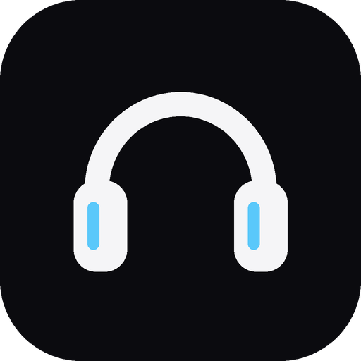

# 🎧 耳机佩戴报告 · Headphone Health Report


> 把 Apple Health（苹果健康）里的耳机音频暴露数据，变成一份好看、可交互的佩戴报告。
> **全程在本地浏览器完成解析，健康数据不上传、不联网、不留痕。**

**当前版本：`v3.2.0`（iOS 15/16 系统风 · 去假反光）**（构建 2026-11-20 12:20）
页面顶部右上角会显示版本号，可用于确认线上部署是否为最新版本。

一个单文件、零后端的网页工具：导入从「健康」App 导出的 ZIP，即可看到佩戴时长、次数、音量、首次 / 末次使用等统计，以及可旋转的 3D 粒子球可视化。支持深浅色切换、多设备识别（AirPods / AirPods Pro / AirPods Max 等），适配手机与桌面。

---

## ✨ 功能特性

| 功能 | 说明 |
| --- | --- |
| 🔒 纯本地解析 | ZIP 在浏览器内解压、分析，数据从不离开你的设备 |
| 📊 核心指标 | 使用时长、佩戴次数、平均 / 最长时长、平均音量、首次 / 末次使用 |
| 🎧 多设备识别 | 按蓝牙标识自动归组，区分 AirPods、Pro、Max 等多副耳机 |
| 🔊 能量加权音量 | 按暴露时长加权计算平均 dB(A)，而非简单算术平均 |
| 🫧 3D 粒子球 | three.js 驱动的交互式粒子可视化，随主题变色 |
| 🌗 深浅色切换 | Liquid Glass 毛玻璃风格，一键切换明暗主题 |
| 📱 响应式 | 手机竖屏横屏、平板、桌面宽屏均适配 |
| 📦 单文件 | 一个 HTML 就是全部，无需安装、无需服务器 |
| 📱 手机优化 | 分片读取 + 流式解压，不把整个 ZIP 读进内存，430MB 数据峰值仅几十 MB |
| 📲 可安装 | 支持「添加到主屏幕」，像 App 一样全屏运行，有独立图标、无地址栏 |

---

## 🚀 在线使用（推荐）

打开项目主页（GitHub Pages）：

**<https://ratehop.github.io/headphone-health-report/>**

在 iPhone 上用 **Safari** 打开即可，点「选择文件」导入健康数据 ZIP，等待几秒到几十秒（取决于数据量），报告就出来了。

> 💡 **为什么推荐在线版？** iOS 的 Safari 不注册本地 HTML 文件的打开方式，AirDrop 传 HTML 过去往往会卡在「文件」App 里打不开。用 https 网址访问则完全没有这个问题——网址点开即用，导出 ZIP 后直接在网页里选文件就行。

---

## 📥 下载使用

如果你想把网页存到本地、离线用，或分享给别人：

| 方式 | 链接 / 操作 |
| --- | --- |
| 下载单文件 HTML（**仅适合电脑**） | [index.html](https://raw.githubusercontent.com/ratehop/headphone-health-report/main/index.html)（右键「另存为」）。⚠️ 手机上**不要**下载到本地打开，会因 iOS 的本地文件限制失败，手机请直接用上面的在线网址 |
| 下载整个项目 | 仓库页面点 **Code → Download ZIP** |
| 本地打开 | 双击 `index.html`，用 Chrome / Edge / Safari 打开均可 |

> ⚠️ 本地 `file://` 方式在 iOS Safari 上受限（见上文），在桌面浏览器和 Android 上正常。手机端建议优先用在线版。

---

## 📋 如何导出 Apple Health 数据

报告的数据来源是 iPhone「健康」App：

1. 打开 iPhone 上的 **「健康」App**
2. 点右上角 **头像 / 个人资料**
3. 滑到最底部，点 **「导出所有健康数据」**
4. 等待系统打包（数据量大的话可能要几分钟）
5. 把生成的压缩包（通常叫 `导出.zip`）通过 AirDrop / 微信 / 云盘传到你要打开报告的 device
6. 在报告页面点 **「选择文件」**，选中这个 ZIP

> 只需要导出的 ZIP 本身，不需要解压。工具只读取其中的 `export.xml`。

---

## 🔒 隐私与安全

- **不上传**：所有解压与统计都在浏览器内存中完成，页面没有把数据发往任何服务器的逻辑
- **不落盘**：关闭页面后数据即消失
- **零外链**：HTML 内的 JSZip、three.js、Framework7 CSS、设备图片全部内联，页面运行不请求外部资源
- **可审计**：单文件源码公开，可自行检查网络请求

如果你对隐私有更高要求，下载单文件后断网使用即可——工具不依赖网络。

---

## 🌐 浏览器兼容性

| 平台 | 在线版（https） | 本地版（file://） |
| --- | --- | --- |
| iPhone Safari | ✅ **推荐**（唯一支持「添加到主屏幕」） | ❌ 系统限制，打不开 |
| iPhone Edge | ⚠️ 选文件后会重载页面（Edge 已知问题），建议换 Safari | ❌ |
| iPhone Chrome / 夸克 | ✅ | ⚠️ 部分可用，因浏览器而异 |
| Android 浏览器 | ✅ | ✅ |
| macOS / Windows 桌面 | ✅ | ✅ |

> ℹ️ 手机端建议使用 **iOS 16.4 及以上**（含 iOS 版 Chrome / 夸克 / 微信内置浏览器）。该版本起支持原生流式解压，能把 430MB 的健康数据控制在约 90MB 内存内完成解析。旧版本会自动切换到兼容模式，但因需整体解压，占用内存较高，处理大导出文件时可能较慢。

---

## 🛠 技术实现

- **Zip 解析**：优先走浏览器原生 `DecompressionStream` 流式解压（iOS 16.4+），自己解析 ZIP 中央目录，只把目标 XML 的原始 deflate 数据流式展开；不支持时自动回退 JSZip（内联）
- **低内存扫描**：用 `indexOf('HeadphoneAudioExposure')` 定位后回溯标签起点，比对全部 `<Record>` 跑正则快数倍，解析缓冲区稳定在 256KB
- **数据算法**：按 `localIdentifier` 归组设备、重叠区间去重、5 分钟间隔估算佩戴、能量加权平均音量
- **设备白名单**：只统计 AirPods 全系 / Pro / Max / EarPods，其他品牌与未命名设备自动屏蔽
- **可视化**：three.js r128 `BufferGeometry` + `ShaderMaterial` 粒子球
- **UI**：Framework7 iOS 风格 CSS + 自定义 Liquid Glass 毛玻璃
- **构建**：单文件 HTML，所有依赖与图片（WebP）内联

---

## 📲 装成 App 用（推荐）

打开在线链接后，可以把它添加到主屏幕，变成独立图标、全屏无地址栏，跟原生 App 一样：

1. **iPhone**：用 **Safari** 打开网址 → 底部「分享」→ 「添加到主屏幕」（Edge / Chrome 的手机版没有这个入口，必须用 Safari）
2. **Android**：Chrome 打开网址 → 右上角菜单 → 「添加到主屏幕」

之后每次从桌面图标点开即可，不用再输网址。数据依然只在手机上解析。

---

## ⚠️ 为什么一定要用 https 网址打开

在 iPhone 上，**用浏览器直接打开本地 HTML 文件（AirDrop 传过去的那种）是走不通的**，这不是本项目的问题，而是 iOS 的系统限制：

| 现象 | 原因 |
| --- | --- |
| Safari「打开方式」里根本没有它 | iOS Safari 不把 `file://` 的 HTML 注册为可打开类型，只能进 Quick Look 预览，JS 不执行 |
| Edge 打开后，一点「选择文件」就刷新回首页 | 本地文件模式下 Edge 用的是临时副本（`edge://external-file/...`），调用系统文件选择器会导致页面重建，副本随即失效 |
| 第二次再打开提示「无法访问此页面」 | 上面那份临时副本已经被清理掉了 |
| 提示「The I/O read operation failed」 | WebKit 下若在 `change` 事件里清空 `input.value`，刚拿到的 File 句柄会失效。v2.1.0 已修正 |

**结论：把本仓库发布到 GitHub Pages，用 `https://` 网址打开，上述问题全部消失**，且健康数据依然只在手机本地解析。

> 📌 页面顶部右上角显示版本号（如 `v3.2.0`），可以据此确认线上是否已部署最新版本。

---

## 🗒 更新记录

### v3.2.0（2026-11-20）· 去假反光，配色回到 iOS 系统级
**上一版"很 low"的两个具体原因，都拿掉了**

- 删掉每张卡片顶部的 `linear-gradient` 白色高光条（`.glass::before`）—— 这条 1px 假反光贴在每个模块上，是廉价感的主因
- 删掉蓝 / 紫 / 青三色环境光晕 —— 三色叠在分组底色上会互染成脏色，配色"脏"就是从这来的
- 全站换成 iOS 系统色板：浅色 `#F2F2F7` 分组底 + `#FFFFFF` 卡片；深色 `#000000` 底 + `#1C1C1E` 卡片；强调色 `#007AFF` / `#0A84FF`
- 卡片不再磨砂：改为不透明实色 + 0.5px 淡描边 + 1px 极浅投影，靠描边分层而不是靠反光
- 全站只剩**底部悬浮导航栏**一层真毛玻璃（控件层半透明、内容层实色，这才是 iOS 的层级逻辑）
- 分段控件重做成 iOS `UISegmentedControl`：灰色轨道 + 白色药丸 + 细投影
- 大标题 32px/700、大数字字距收到 -1.4px 并启用 `tabular-nums`，图标底改为系统蓝淡底
- 体积 1.08MB → 1.08MB（纯样式改动，未增依赖）

### v3.1.0（2026-11-20）· 鸿蒙 6「沉浸光感」材质
**在 MD3 骨架上加入半透明毛玻璃，底部导航改回悬浮**

- 材质按 HarmonyOS 6 沉浸光感参数实现：高斯模糊 24px、饱和度 1.4×、1px 内描边（白 12%）、圆角 22–28px、顶部 1px 高光、投影 `0 12px 32px`
- 底部导航改为**悬浮胶囊**（左右各 14px、距底 14px、34px 全圆角），毛玻璃 + 内描边 + 悬浮投影
- 背景加回柔和环境光晕（三处低透明度径向光），让毛玻璃真的有东西可糊，而不是在纯色上假装透明
- 卡片 / 数据瓦片 / 设备卡 / 分享抽屉全部改为半透明磨砂层
- 顶栏右上角深浅色开关触控区放大到 **44×44**（图标 21px），首页 GitHub / 开源工具按钮也加高到 44px

### v3.0.0（2026-11-20）· Material Design 3 重构
- 删除 Framework7 iOS 主题（485KB）与全部 Liquid Glass 假高光
- 改用 MD3 色彩角色 + surface-container 平面分层，顶栏 / NavigationBar / Filled & Outlined 按钮 / Segmented Button / 全站水波纹
- 文件体积 1.57MB → 1.08MB

### v2.6.1（2026-11-20）
**新增「分享」能力，解决链接不好发的问题**

- 底部导航新增第 4 个 tab **分享**：大号二维码 + 「分享」（调用系统分享面板，可直接发微信 / 信息）+「复制链接」
- 首页新增 **分享给朋友** 入口，不用先导入数据也能调出二维码浮层
- 二维码是矢量外的独立 PNG 内联，**长按图片即可保存 / 识别**，适合截图发微信
- 明确提示：该地址不公开，**没有链接打不开、搜索引擎也搜不到**，只能发链接或二维码

### v2.5.0（2026-11-20）
**UI 整体重构**

- 底部菜单栏恢复**悬浮**：`position:fixed` + `translateX(-50%)`，距底 14px，24px 圆角，两侧留白 14px，最大宽度 392px
- 顶栏重排：左侧 `GitHub / 开源工具`，右侧 `版本号 + 深浅色开关`，两者分列两端并用 `gap` 隔开，长文案自动省略，不再和主题开关挤在一起
- 统一角标尺寸：版本号高 24px、主题按钮 24×24 圆、tab 指示点定位到 tab 底部居中
- 页面底部留白改为 `calc(88px + env(safe-area-inset-bottom))`，内容不会被悬浮菜单遮挡

### v2.4.0（2026-11-20）
**修复「选完文件页面刷新 / 重载回首页」的根因**（前两版只做了外围防护，没治到病）

- **无限递归重试**：旧代码在原生解压失败时递归调用 `analyze()`，而负责判断的局部变量每轮都被重置，导致失败→重试→再失败→再重试无休止。几毫秒一轮疯狂创建流对象，iOS 上内存被瞬间打爆 → WebProcess 被系统回收 → 页面重载回首页。现在最多只回退一次。
- **TypedArray 视图被 detach**：旧代码把 `u8.subarray()` 视图塞进 `ReadableStream`，其底层是整 22MB buffer，Safari 转移 buffer 时视图失效 → 解压抛错 → 触发上面的无限递归。现改为 `File.slice().stream()`，切片即独立 Blob。
- **不再读整包**：定位 XML 只读文件尾部 66KB + 中央目录，解压直接消费 `Blob` 切片。内存从「22MB 整包 + 430MB 解压」降到几十 KB 流缓冲。
- 首页底部新增**阶段诊断**：若导入中途被打断，重新打开会显示上次卡在哪一步（`read` / `parse` / `retry` / `error`）
- 点击选择按钮不再修改 `input.value`，改为解析结束后清空，避免干扰系统文件选择器

### v2.3.0（2026-11-20）
- 新增设备/环境诊断：首页底部显示 `iOS 版本 · 流式解压可用/不可用 · 版本号`
- 识别 iOS 版 Edge 并提示改用 Safari（Edge 选文件后会重载页面，属其已知问题），提示条内置「复制链接」按钮
- 错误页附带环境信息与本次实际使用的解压方式，便于定位问题

### v2.2.0（2026-11-20）
- 新增 PWA 支持：`apple-touch-icon` / `apple-mobile-web-app-*` / 深浅色 `theme-color`，可添加到主屏幕当 App 用
- 内置耳机造型图标（180 / 512 两档，PNG 内联，零外链）
- 状态栏配合 `viewport-fit=cover` 适配刘海屏

### v2.1.0（2026-11-20）
- 顶部新增版本号徽章，方便确认线上部署是否最新
- 修复 `change` 事件中清空 `input.value` 导致 File 句柄失效（`The I/O read operation failed` 的根因）
- 本地文件模式下显示针对性提示，并检测「选完文件后页面被重建」的中断
- 统一 README 中的仓库名与在线地址

### v2.0.0（2026-11-20）
- 改用原生 `DecompressionStream` 流式解压，430MB 数据内存占用从 ~1.4GB 降到 ~90MB
- 新增 AirPods / EarPods 设备白名单，其他品牌与未命名设备自动屏蔽
- 低内存扫描（`indexOf` 定位 + 回溯标签），解析缓冲区稳定 256KB

### v1.0.0（2026-11-19）
- 首个版本：ZIP 本地解析、三页 iOS 风格报告、three.js 粒子球、深浅色切换

---

## 📁 项目结构

```
headphone-health-report/
├── index.html              # 单文件应用（也是 GitHub Pages 首页）
├── README.md               # 本说明
├── LICENSE                 # MIT 许可
├── THIRD_PARTY_NOTICES.md  # 第三方库许可声明
└── .nojekyll               # 确保 GitHub Pages 正确处理静态文件
```

---

## 📄 许可

本项目代码采用 [MIT License](./LICENSE)。

项目内嵌的第三方库（JSZip、pako、three.js、Framework7）各有其许可，详见 [THIRD_PARTY_NOTICES.md](./THIRD_PARTY_NOTICES.md)。

设备图片版权归 Apple Inc. 所有，仅用于个人数据可视化展示。

---

## 🙏 致谢

- [JSZip](https://github.com/Stuk/jszip) — 浏览器内 ZIP 解析
- [three.js](https://github.com/mrdoob/three.js) — 3D 粒子球
- [Framework7](https://github.com/framework7io/framework7) — iOS 风格 UI
- Apple Health — 原始数据来源
